# Labs64.IO :: Commons

**The shared libraries every Labs64.IO service is built on.**
*Part of the [Labs64.IO Ecosystem](https://labs64.io): the Java and Python libraries and the build parent behind every module.*

[**Get started**](https://labs64.io/docs/development/shared-libraries.html) · [Features](#features) · [AI agents](#using-it-with-ai-agents) · [Ecosystem](#the-labs64io-ecosystem) · [Documentation](https://labs64.io/docs/development/contributing.html) · [labs64.io](https://labs64.io)

> [!NOTE]
> Consume Commons through the `labs64io-parent` POM: one version pins the Spring Boot line, the shared dependency versions **and** every library, so libraries are declared without a version.

## Why Commons?

Services that each re-implement tenant headers, OpenAPI metadata and authorization plumbing drift apart, and the differences are exactly where bugs and security holes live. Commons is that plumbing, written and tested once.

1. **One trust contract.** Every service parses the same `X-Auth-*` headers the same way, in Java and in Python, pinned to identical behaviour by shared test vectors.
2. **One build parent.** `labs64io-parent` carries the Spring Boot line, security overrides and release rules for every Java module.
3. **Authorization that follows the contract.** Policies and routes are generated from OpenAPI; the Data PEP turns a Cerbos query plan into a JPA `Specification`.

**A good fit if**

- You build Java (Spring Boot) or Python services that sit behind the Labs64.IO API Gateway.
- You want your service to parse the trusted identity headers exactly as the rest of the platform does.
- You generate authorization policies from your OpenAPI contract.

**Probably not what you need if**

- Your services are not behind the Labs64.IO gateway: the auth-context libraries assume its header contract.
- You need a general-purpose utility library: these are purpose-built platform libraries.

## Features

- **`labs64io-parent`**: the build parent of every Java library and service; Spring Boot line, BOM security overrides, shared versions and release rules.
- **`auth-context-*`**: dependency-free model and parser, a Spring Boot starter (fail-closed enforcement, `@RequireScopes`, outbound propagation, test support) and a Python mirror (ASGI middleware, FastAPI dependencies, httpx hook).
- **`openapi-spring-boot-starter`**: shared springdoc runtime servers, bearer security and canonical OpenAPI metadata.
- **`openapi-schema-generator`**: versioned JSON Schema documents from OpenAPI 3.1 `$schema` fields.
- **`authz-queryplan-jpa`**: translates a Cerbos `PlanResources` query plan into a Spring Data JPA `Specification` (Data PEP).
- **`auth-policy-cerbos`**: the policy-generation toolkit that derives the central PDP's policies from OpenAPI.
- **Shared test vectors**: Java and Python implementations are pinned to identical behaviour.

## What is in the box

| Library | Language | What it gives you |
|---|---|---|
| [`labs64io-parent`](labs64io-parent/) | Maven POM | The build parent: Spring Boot line, security overrides, shared versions and release rules in one version |
| [`auth-context-core`](auth-context-java/auth-context-core/) | Java 17+ | The identity model, holder and trusted-header parser, with no dependencies |
| [`auth-context-spring-boot-starter`](auth-context-java/auth-context-spring-boot-starter/) | Java 17+ / Spring Boot 4 | Fail-closed header enforcement, `@RequireScopes`, outbound propagation and test support |
| [`auth-context-python`](auth-context-python/) | Python 3.13+ | The same contract for ASGI and FastAPI services, with an httpx hook and pytest fixture |
| [`openapi-spring-boot-starter`](openapi-spring-boot-starter/) | Java 17+ / Spring Boot 4 | Shared springdoc servers, bearer security and canonical OpenAPI metadata |
| [`openapi-schema-generator`](openapi-schema-generator/) | Java 17+ | Versioned JSON Schema documents from OpenAPI 3.1 |
| [`authz-queryplan-jpa`](authz-queryplan-jpa/) | Java 17+ / Spring Boot 4 | Turns a Cerbos query plan into a JPA `Specification` (Data PEP) |
| [`auth-policy-cerbos`](auth-policy-cerbos/) | Shell + OpenAPI | The toolkit that derives the central policy engine's policies from your contract |

The Java and Python implementations are pinned to identical behaviour by the shared vectors in [`test-vectors/`](test-vectors/).

## Using it with AI agents

The trusted-header contract and test vectors are explicit, so an agent can rely on one mental model across services. The [guide for AI agents](https://labs64.io/docs/introduction/ai-agents.html) covers authentication, retries and errors across all modules. Working on this repository with an agent? [`AGENTS.md`](AGENTS.md) describes the layout, release rules and test commands.

## The Labs64.IO Ecosystem

Commons is one module of the [Labs64.IO Ecosystem](https://labs64.io); [every module is documented here](https://labs64.io/docs/).

| Module | What it does | Link |
|---|---|---|
| **AuditFlow** | Audit-event routing pipeline | [labs64.io-auditflow](https://github.com/Labs64/labs64.io-auditflow) |
| **API Gateway** | Authenticating, policy-enforcing edge for all modules | [labs64.io-authproxy](https://github.com/Labs64/labs64.io-authproxy) |
| **Payment Gateway** | One API over multiple payment providers | [labs64.io-payment-gateway](https://github.com/Labs64/labs64.io-payment-gateway) |
| **Checkout** | Embeddable, brandable checkout | [labs64.io-checkout](https://github.com/Labs64/labs64.io-checkout) |
| **Reporting** | Read-only reports over the events AuditFlow stored | [labs64.io-reporting](https://github.com/Labs64/labs64.io-reporting) |
| **Customer Portal** | Customer self-service UI | [labs64.io-customer-portal](https://github.com/Labs64/labs64.io-customer-portal) |
| **Commons** | Shared Java and Python libraries | [labs64.io-commons](https://github.com/Labs64/labs64.io-commons) |
| **Helm Charts** | Kubernetes deployment for every module | [labs64.io-helm-charts](https://github.com/Labs64/labs64.io-helm-charts) |
| **Workspace** | Dev container and multi-repo tooling | [labs64.io-workspace](https://github.com/Labs64/labs64.io-workspace) |
| **Tests** | Cross-module regression suite | [labs64.io-tests](https://github.com/Labs64/labs64.io-tests) |
| **Docs** | Published documentation | [labs64.io-docs](https://github.com/Labs64/labs64.io-docs) |
| **NetLicensing** | Licensing-as-a-Service: license and entitlement management | [netlicensing.io](https://netlicensing.io) |
| **GuideChimp** | Interactive guided product tours | [labs64.com/guidechimp](https://www.labs64.com/guidechimp/) |

## Contributing

We would love your help. A change to a shared library reaches every service, so tests (and, for the header contract, shared test vectors) are not optional. Fork the repository, make your change on a branch, run the checks described in [`AGENTS.md`](AGENTS.md) and open a pull request. Not sure whether an idea fits? Open an issue first and we will talk it through; that is a perfectly good way to start.

## License

Everything in this repository is open source under the [Apache License 2.0](LICENSE): you can use it, change it and ship it commercially. The core of the *Labs64.IO Ecosystem* is free forever; community modules are Apache-2.0 licensed.

---

   
  Made by the <a href="https://labs64.io">Labs64</a> team and community.

