# Labs64.IO :: Commons

**The shared libraries every Labs64.IO service is built on.** Commons is the shared plumbing for tenant headers, OpenAPI metadata and authorization, written and tested once so that services do not each re-implement it. It provides Java and Python libraries that parse the trusted `X-Auth-*` headers the same way, a build parent for every Java module, and tooling that generates authorization policies from OpenAPI.

## The Labs64.IO Ecosystem

Commons is part of the [Labs64.IO Ecosystem](https://labs64.io). Its documentation is at [labs64.io/docs/development/shared-libraries](https://labs64.io/docs/development/shared-libraries.html); [all modules are listed in the documentation](https://labs64.io/docs/services/).

---

   
  Made by the <a href="https://labs64.io">Labs64</a> team and community.

